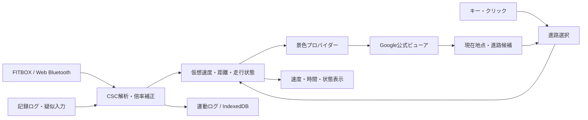

# FITBOXで現実の街を走るブラウザアプリ：実現性と技術構成

調査日：2026-10-21。対象はMacのChrome、日本の請求先を持つ個人開発を想定する。料金は調査時の公開USD価格で、税・為替・個別契約を含まない。APIの動作確認と課金の実測はまだ行っていない。

## 1. 推奨する進め方

**第一候補はGoogle Maps JavaScript APIのStreet Viewを使い、撮影地点間をペダル入力で移動し、分岐で左右・直進を選ぶ方式。** 希望する「街の景色を見ながら、その場で道を選ぶ」体験に近く、初期段階では自前の道路データや経路検索サーバーを持たずに検証できる。

ただし、作れるのは撮影地点を順にたどる体験であり、連続動画や自由に位置を動かせる3D空間ではない。さらに、APIの隣接リンクは道路交通上の交差点を表すデータではない。この2点を許容できるかが最大の判断材料になる。

最初の試作は「Street View単体＋自由分岐＋仮想速度＋運動記録」に絞る。必要ならGoogleの小さな地図を追加する。地図方式への代替案はMapLibre GL JS＋OSM道路グラフとし、Googleの景色とOSM地図を組み合わせる構成は採用しない。

これはAPI仕様からの設計上の評価であり、サービス側から本アプリの利用許可を個別に取得したものではない。規約上の実装条件と、未確認事項は後述する。

## 2. 要件と現時点の前提

| 項目 | 前提・優先順位 |
| --- | --- |
| 実機入力 | FITBOX-03807、CSC Service `0x1816` / Measurement `0x2A5B` |
| 確認済み | ユーザー環境でブラウザから通知を受信できた |
| 未確定 | Wheel / Crankと実際のペダル回転の倍率・対応関係 |
| 画面 | Street Viewのような地上の景色を優先。見下ろし地図は代替候補 |
| 進路 | プレイ中に選択を優先。事前設定ルートは追加候補 |
| 操作 | ペダルで前進。進路選択はキーボード・クリックから開始 |
| 速度 | ケイデンスから計算する「仮想速度」。実際の走行速度や仕事率ではない |
| 対象 | 屋内の運動。現実の道路で使うナビゲーション機能は対象外 |

センサー自体から左右の操舵入力が得られることは確認されていない。分岐の選択には別の操作が必要。将来はゲームパッド等を足せるが、初期版は矢印キー＋Enterで十分。

## 3. 選択肢の比較

以下の難易度・適合度は、本アプリの要件に対する設計判断。

| 案 | 景色・移動 | 走行中の分岐 | 規約・運用上の主な条件 | 評価 |
| --- | --- | --- | --- | --- |
| A. Google Street View / Maps JavaScript API | 全周写真を撮影地点単位で移動 | 隣接リンクから候補を選ぶ | Google帰属表示、保存制限、他社地図との併用制限、課金設定 | **第一候補** |
| B. MapillaryJS＋Mapillary画像 | 通常写真・360°写真。対象地域次第 | シーケンスと空間的接続を使う | 画像ライセンスとAPI規約を別々に確認 | 第二候補。日本の希望地域での密度調査が先 |
| C. MapLibre GL JS＋OSM | 見下ろし地図上で滑らかに移動 | 道路グラフを用意すれば制御しやすい | ODbL、タイル配信元の条件、経路データの準備 | 地図体験を優先する場合に有力 |
| D. 自分で撮影した360°写真・動画 | 撮影と編集次第で品質を管理可能 | 撮影済みの分岐だけ | 撮影素材の権利・プライバシー、配信費用 | 狭い地域・固定コース向け |

GoogleのAPI機能は[Street Viewガイド](https://developers.google.com/maps/documentation/javascript/streetview)、Mapillaryの移動機能は[Viewer API](https://mapillary.github.io/mapillary-js/api/classes/viewer.Viewer/)、地図描画は[MapLibre公式](https://maplibre.org/maplibre-gl-js/docs/)、自前写真表示は[Photo Sphere Viewer](https://photo-sphere-viewer.js.org/)で確認できる。

## 4. A案：Street View＋自由分岐

### APIでできること

`StreetViewService.getPanorama()`で開始地点付近の撮影地点を探し、`StreetViewPanorama`で表示する。`getLinks()`は隣接先のpano ID・方角・説明を返し、`setPano()`で移動、`setPov()`で向きを変えられる。[Street View APIリファレンス](https://developers.google.com/maps/documentation/javascript/reference/street-view)

この公開APIだけで、ペダルによる前進とボタンによる分岐選択を組み立てられる。GoogleマップのWeb画面をiframeで埋め込み、内部のボタンを外から操作する方式は使わない。公式のAPIを直接利用する。

### 前進と分岐の処理案

1. 開始地点と最初の進行方向を選ぶ。
2. 現在の撮影地点のリンクを取得し、直前にいた地点への戻りリンクを識別する。
3. 進行方向とリンクの方角差から、直進候補・左右候補を分類する。画面を見回した向きと進路の向きは別に保持する。
4. 通常区間はペダルから算出した仮想距離が閾値に達したら次へ進む。
5. 有効な進路が複数なら選択UIを表示し、確定まで前進を止める。運動計測は継続し、選択待ちの回転を移動距離として貯め込まない。
6. 移動リクエストは常に1件ずつ処理する。完了・失敗を確認してから次へ進む。
7. 行き止まりは引き返し・開始地点変更を選べるようにする。

APIから得られるのは「写真の接続」であり、法的に通行可能な道路の完全な一覧ではない。最初のUIは「交差点検出」と断定せず「進路の候補」として扱う。単純なリンク数判定だけでは誤るため、以下を実機で検証する。

| 問題 | 対策案 |
| --- | --- |
| 同じ方向に複数リンクがある | 方角差・移動距離・直前の地点を使って候補を整理。曖昧ならユーザー選択 |
| 複雑な交差点で何度も選択が出る | 選択後は一定距離・地点数の間、同じ方向を優先する |
| 近くの別道路・立体交差に飛ぶ | 通常移動は隣接panoを優先。位置の最近傍検索だけで前進させない |
| 戻りリンクを消すと引き返せない | 「引き返す」を常に別操作として残す |
| リンク取得が遅い | 候補が揃うまで停止表示。API未取得を行き止まりと決めつけない |
| 画像がない・読み込み失敗 | 停止して再試行・引き返し・地点変更。勝手に別道路へ飛ばさない |

### 移動の見え方と距離

撮影地点は離散的なので、速度を細かく変えても画像の移動は段階的になる。向きの調整はできるが、画像間の連続移動や切り替えの演出を完全に制御できるとは限らない。公式ビューアで10〜20分走り、切り替わりの頻度・読み込み待ち・酔いやすさを確かめる。

当初は「一定の仮想距離ごとに1地点進む」方式でも体験を評価できる。次に、現在と隣接先の座標をAPIで取得して地点間距離を使う。ただし座標間の直線距離は、カーブを含む道路に沿った距離とは一致しない。画面では「仮想距離」と表示する。

写真の撮影年・季節・画角が途中で変わることがある。パノラマIDも永続的な道路IDではなく、画像の更新に伴い変わり得る。保存ルートをpano IDだけで恒久的に再現できると約束しない。[Street Viewのデータ取得仕様](https://developers.google.com/maps/documentation/javascript/streetview#StreetViewServiceRequests)

### 事前設定ルートを追加する場合

出発地・目的地・経由地からRoutes API等で道路上の経路を取得し、その経路と撮影地点のリンク列を対応付ける。**経路検索の結果をStreet Viewに渡すだけで自動走行できるわけではない。** 道路上の経路が存在しても写真がつながっていない区間はあり得る。

曲がり角を越えて最近傍画像に飛んだり、同じ画像を繰り返さないよう、方角・前回pano・経路の進行距離を状態として管理する。対応できない区間では停止して案内する。初期の固定コースは数百m〜数kmの手動確認済み区間に限定すると評価しやすい。

Routes APIは経路の形状や案内を返すAPIであり、任意の交差点に接続する全道路グラフを取得するAPIとしては扱わない。[Routes API公式](https://developers.google.com/maps/documentation/routes/compute_route_directions)

自転車モードの提供可否は対象地域とAPIで確認する。Googleマップ製品のUIでできることと、開発者APIでできることを同一視しない。`TWO_WHEELER`はオートバイ等のモードであり、自転車の代替として選ばない。[対応する車両タイプ](https://developers.google.com/maps/documentation/routes/vehicles)

## 5. Google利用時の規約と実装条件

調査対象の一般規約に、運動アプリやゲームという分類だけで一律禁止する記載は確認できなかった。ただし本用途が個別に承認されているという意味ではない。以下の条件を満たす設計で進め、独自の画像加工・保存・再配布が必要になった場合は適用条件を再確認する。

| 論点 | 本アプリの方針 |
| --- | --- |
| 帰属表示 | Google・撮影者等の表示を残す。運動HUDや分岐ボタンで覆わない |
| 画像の保存 | 独自の画像ダウンロード、全コースの先読み、Service Workerでのオフライン保存をしない |
| データの再利用 | Googleの写真・リンクから独自の恒久道路DBを生成しない |
| 他社地図との併用 | Google Street View＋MapLibre/OSMのミニマップを同じ画面に置かない。タブ切り替えを制限回避策として扱わない |
| 独自の価値 | 運動入力・進路選択・運動記録をアプリの中心に据える |

上記は主に一般規約3.2.2(b)、3.2.3(a)〜(e)に基づく設計上の整理。[Google Maps Platform一般規約](https://cloud.google.com/maps-platform/terms)

保存できるIDには例外があるが、サービス固有の条件・ドキュメントに従う必要がある。**pano IDが保存できることと、画像・メタデータ・リンク列を自由に保存できることは別。** 初期版の永続ログはセンサー値・運動時間・アプリ自身の仮想距離に絞り、Google由来の位置・説明・リンク情報を既存のJSONログへ無条件に混ぜない。保存コースの形式は利用APIを確定した段階で設計する。[サービス別規約・IDキャッシュ](https://cloud.google.com/maps-platform/terms/maps-service-terms)

公開アプリにはGoogleの利用条件を反映した利用規約・プライバシーポリシーを用意する。BLEデータをクラウドへ送らなくても、地図のリクエストはGoogleへ送られることを説明する。[Maps JavaScript APIポリシー](https://developers.google.com/maps/documentation/javascript/policies)

## 6. Googleの料金と費用の見積もり

**Maps JavaScript APIのDynamic Street Viewは、同じビューアで撮影地点を切り替えるたびに新しい表示オブジェクトを生成する必要はない。** 公式SKU詳細ではパノラマオブジェクトのインスタンス生成ごとに課金するとされている。`setPano()`の回数とオブジェクト生成数を区別する。[公式SKU詳細](https://developers.google.com/maps/billing-and-pricing/sku-details#dynamic-street-view)

Reactの再描画・画面切り替え・開発時のStrict Mode等で意図せず再生成しないようにする。隠した2個目のビューアで画像を先読みする実装も初期版には入れない。課金の想定はCloud Consoleの実際のSKU利用量で検証する。

調査時のGlobal料金表は以下。無料枠は月間・SKU単位であり、同じ請求先での他用途も考慮する。

| SKU | 月間無料枠 | 最初の有料帯の単価（1,000件あたり） |
| --- | ---: | ---: |
| Dynamic Street View | 5,000 | $14 |
| Dynamic Maps | 10,000 | $7 |
| Static Street View | 10,000 | $7 |
| Street View Tiles | 100,000 | $2 |
| Routes: Compute Routes Essentials | 10,000 | $5 |

有料帯の上限はDynamic系・Routesで月100,000件、Tilesで月1,000,000件。追加機能でRoutesのSKUが上位になる場合がある。[Google公式料金表](https://developers.google.com/maps/billing-and-pricing/pricing)

試算は本アプリの仮定に基づく。1セッションでStreet Viewの表示オブジェクトを1回だけ生成し、他用途の消費がない場合：

| 利用規模の仮定 | 月間生成数 | Dynamic Street View分の概算 |
| --- | ---: | ---: |
| 個人、1日2回×30日 | 60 | 無料枠内 |
| 100人、各1日1回×30日 | 3,000 | 無料枠内 |
| 1,000人、各1日1回×30日 | 30,000 | (30,000−5,000)÷1,000×$14＝**$350/月** |

セッション中の再読み込み・再生成は加算される。地図・検索・経路検索・ホスティングの費用はこの試算に含まない。

代替のStatic APIで「30分、2秒に1枚」の画像を更新すると900リクエスト/回になり、100回/月なら90,000件、単純計算で($7×80,000÷1,000)＝$560となる。全周を見回す体験も作りにくいため、今回の第一候補にはしない。Street View Tilesはタイル・サムネイル・pano ID取得が課金対象となり、1回の走行が何件になるか画質と実装に依存する。独自レンダラーが必要になった段階で比較する。[課金イベントの定義](https://developers.google.com/maps/billing-and-pricing/sku-details)

初回試作にもGoogle Cloudプロジェクト、課金アカウント、APIキーが必要。ブラウザ用キーにはHTTPリファラー制限とAPI制限を設定する。ブラウザへ配布するキーを秘密情報として隠せるとは考えない。サーバー用キーは別管理にする。[APIセキュリティガイド](https://developers.google.com/maps/api-security-best-practices)

予算アラートは通知であり、自動的な支払上限とは扱わない。利用できるクォータ制限と、アプリ側のセッション開始制限・エラー時の停止を併用する。[Googleの費用管理ガイド](https://developers.google.com/maps/billing-and-pricing/manage-costs)

## 7. B案：Mapillaryで地上の景色を表示

MapillaryJSは`moveTo(imageId)`と`moveDir(direction)`を持ち、写真間の移動を操作できる。撮影順のシーケンス移動と、近くの写真へ移る接続を使える。ただし、リンクが未取得・存在しない場合や通信失敗に備えた処理は必要。[MapillaryJS Viewer API](https://mapillary.github.io/mapillary-js/api/classes/viewer.Viewer/)

本用途では、希望する町に「つながる写真が十分あるか」「360°写真か通常写真か」「交差点の曲がり先も撮影されているか」を先に確認する。写真が存在するだけでGoogle Street Viewと同等の全周・連続性を得られると見積もらない。

| 層 | 確認できた内容 | 開発時の対応 |
| --- | --- | --- |
| MapillaryJS | MITライセンス | ライセンス表示を保持。[ライセンス](https://github.com/mapillary/mapillary-js/blob/main/LICENSE) |
| 写真 | 公式説明はCC BY-SA | 撮影者・元画像・ライセンスへの帰属表示。加工物を配布する場合は継承条件を確認。[画像ライセンス説明](https://help.mapillary.com/hc/en-us/articles/115001770409-CC-BY-SA-license-for-open-data) |
| サービス利用料 | 公式FAQは商用・趣味等を含め無料と説明 | 運用可用性や無制限のアクセスまで保証されたとは扱わない。[公式FAQ](https://help.mapillary.com/hc/en-us/articles/8348198426396-Mapillary-FAQ) |
| APIアクセス | 開発者登録・アクセストークン等を利用 | レート上限、キャッシュ、商用条項の本文を採用前に再確認 |

画像のCC BY-SAがアプリの全ソースコードを自動的に同じライセンスにするとは扱わない。画像の改変・結合・再配布に適用される条件と、ソフトウェアのライセンスを分けて整理する。

調査では[APIドキュメント](https://www.mapillary.com/developer/api-documentation/)と[利用規約](https://www.mapillary.com/terms)のページ本文を取得できなかった。正確なレート上限やAPI固有の保存・商用条件は未確認であり、**「無料で無制限に取得・保存できる代替」としては推奨しない。** Mapillaryを採用する場合は、この確認と対象地域のカバレッジ試験を先に行う。

## 8. C案：MapLibre＋OSMで見下ろし地図を走る

MapLibre GL JSはブラウザでベクトル地図を描くライブラリで、BSD-3-Clauseライセンス。地図のデータや配信サービスを含む製品ではない。[公式ドキュメント](https://maplibre.org/maplibre-gl-js/docs/)、[ライセンス](https://github.com/maplibre/maplibre-gl-js/blob/main/LICENSE.txt)

地図上のマーカーを道路に沿って連続移動させることは容易だが、任意の交差点で道を選ぶには、表示用タイルとは別に道路の接続情報が要る。画面上の線が交差しているだけでは、橋・トンネルを含む正しい接続を判定できない。

### 必要なデータと処理

- 対象地域のOSM道路データから、ノードとエッジのグラフを用意する。
- 交差点までのエッジ上を進み、到着時に接続先エッジを選ぶ。
- `oneway`、`access`、`bicycle`、立体交差、必要に応じてターン制限を扱う。屋内の探索ルールとして通行条件を簡略化するなら、その仕様を明示する。
- 最初は狭い地域を前処理したグラフJSONで足りる。固定コースならポリラインに沿って進むだけで始められる。
- 広域の自由探索では、現在地周辺のグラフを追加取得する仕組みが必要。目的地への経路検索が必要になったら、OSRM等の自前処理か契約したAPIを追加する。

OSRMは経路検索等のAPIを持つが、描画ライブラリから自動的に利用できる機能ではない。自転車向けプロファイルや運用環境は別途準備する。公開デモサーバーへの本番依存を前提にしない。[OSRM公式ドキュメント](https://project-osrm.org/docs/v26.4.0/)

### ライセンス・配信先

OSMはODbLで提供され、帰属表示が必要。加工した道路グラフを公開利用する場合、派生データベースとしての共有条件も検討する。アプリのソースコード全体を必ず公開しなければならないという意味ではない。[OSMの著作権とライセンス](https://www.openstreetmap.org/copyright)

OSMの公式タイルサーバーは無料の無制限ホスティングではなく、事前一括取得やオフライン用ダウンロードに制限がある。本番運用は商用配信先または自前配信を選ぶ。[ラスタータイルポリシー](https://operations.osmfoundation.org/policies/tiles/)、[ベクトルタイルポリシー](https://operations.osmfoundation.org/policies/vector/)

商用配信の具体例はMapTiler。調査時のFreeは試験・個人・非商用向けで、規約では商用品の研究開発も対象に含む。Flexは$30/月から。MapLibreなど他社クライアントで利用するとタイルAPIリクエスト単位になるため、セッション数だけでは費用を見積もれない。[MapTiler規約](https://www.maptiler.com/terms/cloud/)、[料金](https://www.maptiler.com/cloud/pricing/)、[計測単位](https://docs.maptiler.com/guides/account/sessions-vs-requests/)

Google案からこの案へ切り替える場合は、地図・経路・位置検索までOSM系で構成する。Google由来の経路や地点データをOSM地図へ流用することを前提にしない。

## 9. D案：自前の写真・動画

360°写真を自分で撮影するなら、Photo Sphere ViewerとVirtualTourPluginで撮影地点とリンクを定義できる。ライブラリはMITで、全周写真・動画の表示にも対応する。[ライブラリ](https://photo-sphere-viewer.js.org/)、[VirtualTourPlugin](https://photo-sphere-viewer.js.org/plugins/virtual-tour.html)

写真を密に撮れば段階的な前進、動画なら再生速度とペダルを連動させやすい。動画で分岐を実現するには、曲がる方向ごとの動画と分岐接続点を撮影・編集する必要がある。走行できる範囲は素材を用意した範囲になるため、広い街の自由探索より、特定コースの品質を優先する場合に適する。

Googleの画像をダウンロードしてこのビューアへ載せ替える案とは別。自分で権利を持つ、または必要な許諾を受けた素材を使う。

## 10. 推奨する技術スタックと構造

現状のHTML/JavaScript検証アプリを測定用として使い続け、走行アプリは別エントリーにする案。実装時に必要な範囲から移行し、今回の調査ではアプリ本体を変更しない。

| 担当 | 初期版の推奨 | 選ぶ理由 |
| --- | --- | --- |
| 開発・ビルド | Vite＋TypeScript | BLE・画像移動・状態遷移のデータ型を明確にできる |
| UI | React | 接続状態、分岐、運動記録、設定を管理しやすい。小規模なら素のTypeScriptでもよい |
| BLE | Web Bluetooth API＋既存CSC解析 | Mac Chromeで確認済みの処理を再利用 |
| 景色 | Maps JavaScript APIのStreetViewPanorama | 公式ビューアを1個保持して移動を制御 |
| 走行計算 | UIから独立したTypeScriptモジュール | センサー再生・疑似入力で同じ処理を検証できる |
| 永続化 | 小さな設定はlocalStorage、運動ログはIndexedDB | 最初はアカウントとDBサーバーが不要 |
| 配信 | ローカル開発＋静的HTTPS配信 | SSRや常時稼働サーバーは初期版に不要 |
| 将来のサーバー | 経路検索プロキシ、共有ログ等が必要になった段階で追加 | サーバー用キー、利用制限、共有データを扱う |

Web Bluetoothの接続はユーザー操作が必要で、通常の公開配信にはHTTPSが必要。[Chrome公式ガイド](https://developer.chrome.com/docs/capabilities/bluetooth)



プロバイダー境界では「現在地点」「候補」「移動」「向き」を扱う。Googleのpano接続とOSMの道路グラフは別物なので、共通インターフェースだけで完全に置き換えられるとは考えない。Google由来のデータを別プロバイダーの永続DBに持ち込まない。

### センサーから進行量への変換

校正前はWheelとCrankのどちらが正しいかを固定しない。実際に10回・30回まわしたログから、採用するカウンターと倍率を決める。

```text
pedalRpm = measuredRpm / センサー回転数とペダル回転数の比
virtualSpeed_mps = pedalRpm × 仮想的な1回転の距離_m / 60
virtualDistance_m += virtualSpeed_mps × 経過時間_s
```

仮の設定例は「1ペダル回転＝5m」で、60rpmなら18km/h。これはゲーム上の設定値で、機器から測れた速度ではない。停止・通知欠落・BLE切断時の挙動を明示し、単に最後のrpmを無期限に積分し続けない。負荷段階・坂道による実機の抵抗制御は、このCSC入力だけで可能とは確認されていない。

走行状態は `disconnected / ready / riding / choosing / loading / paused / error` を分ける。`loading`や`choosing`中に距離を積み上げすぎて、読み込み完了後に何地点も飛ぶ挙動を防ぐ。背景タブから戻った際も経過時間を丸ごと移動へ加算しない。

## 11. 最初の試作と判断基準

### 段階1：景色の操作性を確認

APIキーを設定し、Street View単体で開始地点・隣接リンク・前進・戻る・方向選択を実装する。まだBLEを必須にせず、ボタンでも同じ走行処理を操作できるようにする。

市街地、住宅街、曲がり角、T字路、複雑な交差点、行き止まりの6種類で確認する。「任意の交差点を完全検出する」ことよりも、接続が途切れたときに回復できることを先に評価する。

### 段階2：BLE入力と接続

既存のCSC解析を接続し、センサー選択・倍率・仮想速度を設定できるようにする。走行中の自由分岐を含め10〜20分動かす。

| 確認項目 | 暫定の合格条件 |
| --- | --- |
| 回転と進行 | 入力を増減すると前進の頻度が変わる。停止・切断後に進み続けない |
| 分岐 | 単純な交差点で左右・直進を選べ、選択待ちに勝手に通過しない |
| 見回し | 景色を横に向けても、進路が意図せず変わらない |
| 失敗時 | 画像欠落やリンク未取得で停止・再試行・引き返しが可能 |
| 体験 | 本人が10〜20分続けて、画像切り替えと待ち時間を許容できる |
| 費用 | パノラマオブジェクト生成回数を把握し、Cloud ConsoleのSKU増分と照合できる |

数値目標を置く場合は、操作から状態表示までの時間、画像移動待ちの中央値・上位95%、意図しない分岐の回数を測る。画像表示の完了と単なるpano ID更新イベントを混同しない。

### 段階3：継続先を選ぶ

- Street Viewの段階的な移動が許容できれば、自由探索を磨き、開始地点の保存・運動記録を追加する。
- 正確な交差点や全道路の自由選択が必要なら、MapLibre＋道路グラフを独立した案として進める。
- 希望地域のMapillary画像が十分なら、その地域だけ比較試作する。API条件の未確認点を解消してから採用する。
- 特定のコースで滑らかな映像を最優先するなら、自前動画の案を検討する。
- 事前ルートは、Google経路とパノラマ接続の対応を検証する別段階として追加する。

## 12. 実装開始時に決める事項

1. 最初に走ってみたい町と開始地点。1地域を選び、写真の連続性を手動確認する。
2. Google Cloudの課金設定と、試作で許容する費用。キー発行と制限設定が必要。
3. Wheel / Crankのどちらを進行量に使うかと、実際のペダル回転との倍率。
4. 分岐時に停止して選ぶ方式でよいか。初期案は矢印キー＋Enter。
5. 写真間の段階的な前進を許容できるか。これはドキュメントだけで結論を出さず、短い試作で判断する。

API・規約に関する事実は各節の公式リンクを参照。速度係数・状態設計・試作の範囲・合格条件は本プロジェクト向けの提案であり、API提供者の保証ではない。
